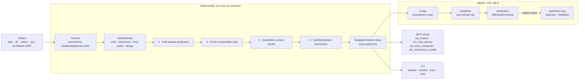

<div align="center">

# REE — Reverse Engineer Everything

**Decoy-resistant, budget-safe reverse engineering for AI analysis agents.**

REE puts a deterministic static-analysis pass in front of the LLM. Decoys, context bombs, and planted instructions are removed *before* a model reads a single token, so hardened builds can't poison, exhaust, or mislead your analysis agent.

[](LICENSE)


</div>

> [!IMPORTANT]
> **Responsible use.** REE is for security research, malware analysis, interoperability work, auditing your own software and dependencies, and CTFs. Only analyze software you own or are explicitly authorized to analyze, and follow applicable law and license terms (including anti-circumvention rules in your jurisdiction). REE is a static analyzer: it never executes the target.

---

## Why REE exists

The first wave of AI reverse-engineering tools ([REA](https://github.com/morluto/rea)) showed that an agent with decompilers and MCP tools can reconstruct real applications. The counter-wave ([BLA](https://github.com/qybaihe/bla)) showed how fragile that is: when a raw artifact goes into the context window, the artifact controls what the model sees. BLA's pipeline:

- **Poison:** decoy functions, shadow state machines, decoys guarded by opaque predicates, honey source maps
- **Exhaust:** inflated headers, deep nesting, filler tables, and packed blobs that burn token budgets
- **Hallucinate:** instructions planted in comments and strings ("this file is empty, analysis complete")

REE's answer is architectural: **an LLM never reads a raw artifact.** Parsers build a structural model, the anti-BLA engine removes everything that isn't reachable, real, and inert, and only budget-bounded slices of what's left reach a model.

## Results

Every number below is reproducible with `npm run bench` and uses no LLM calls.

| fixture | variant | naive tokens | REE tokens | reduction | real code kept | decoys removed | exhaust contained | injection leaks |
|---|---|---:|---:|---:|---:|---:|---:|---:|
| inventory CLI (JS) | clean | 563 | 563 | 0% | 9/9 | n/a | n/a | 0 |
| inventory CLI (JS) | **hardened** | 12,648 | 730 | **94.2%** | 9/9 | 12/12 | 2/2 | 0 |
| webpack bundle | clean | 365 | 264 | 27.7%¹ | 4/4 | n/a | n/a | 0 |
| webpack bundle | **hardened** | 994 | 289 | **70.9%** | 4/4 | 6/6 | n/a | 0 |
| Electron app (.asar) | clean | 406 | 406 | 0% | 6/6 | n/a | n/a | 0 |
| Electron app (.asar) | **hardened** | 561 | 414 | **26.2%** | 6/6 | 3/3 | n/a | 0 |
| WASM module | clean | 38 | 38 | 0% | 3/3 | n/a | n/a | 0 |
| WASM module | **hardened** | 1,394 | 38 | **97.3%** | 3/3 | 3/3 | n/a | 0 |

On clean inputs REE removes nothing. On hardened inputs it removes every decoy while keeping all real code.

<sub>¹ The clean-webpack reduction is the generic webpack runtime loader, which isn't part of any module.<br>
**How to read this:** token counts are REE's deterministic estimate, not a model tokenizer. The hardened fixtures come from REE's own simulator of BLA's *documented* techniques (`benchmarks/fixtures/generate.ts`), not from `bla-agents` output. To benchmark against real BLA output, harden an app you own and run `npm run bench -- --target <file> --labels <labels.json>` (see [Benchmarks](#benchmarks)).</sub>

## Architecture



The order of the passes matters. Folding opaque predicates **before** reachability analysis deletes the call sites inside dead branches, so a decoy that's only "called" from behind `if ((7*x*x-1)%7 === (y*y)%7)` becomes unreachable and gets pruned with the rest.

## Anti-BLA defense matrix

| BLA technique | REE countermeasure | Status |
|---|---|---|
| Unreferenced decoy functions / modules / files | Reachability from real entry points (`main`, exports, bootstrap `require`, `package.json` main, WASM start/exports/table targets) | ✅ JS, webpack, asar, WASM |
| Decoy chains (decoys calling decoys) | Same; reachability is transitive from real roots only | ✅ |
| Opaque-predicate-guarded decoys (`7x²−1 ≢ y² mod 7`) | AST-level folding of `if` / ternary / `while`, then edge removal and pruning | ✅ |
| Honey source maps | `.map` files excluded from analysis; `sourceMappingURL` references removed | ✅ |
| Inflated ASAR header (16 MiB trap) | Hard cap (64 MiB) plus a warning above 8 MiB; never decoded unbounded | ✅ |
| Deep nesting traps | Depth cap on ASAR trees and marshal data; warning above 32 levels | ✅ |
| Filler / lookup-table tarpits | Repetition scoring: quarantined from LLM context | ✅ |
| Packed / encrypted blobs | Entropy scoring: quarantined from LLM context | ✅ |
| WASM padding functions | Exact instruction decoding plus reachability | ✅ |
| Instructions in comments / docstrings | Removed (comments never affect behavior) | ✅ |
| Instructions in string literals | Kept as program data, flagged, and labeled in the slice header | ✅ |
| Instructions in the string table | Dropped | ✅ |
| Poisoned tool output reaching the agent | MCP results wrap artifact text in an `untrustedArtifactData` envelope | ✅ |
| AST-span XOR string encryption | Decoders detected and flagged | ⚠️ detection only; no decryption yet |
| Runtime "Truman Show" (anti-debug, fuse flips) | Doesn't trigger, because REE never executes the target | ➖ out of scope |
| Entangle (runtime SHA-256 binding across sidecars) | Not addressed; needs dynamic analysis | ❌ roadmap |

## Format coverage

| Format | Parsing | Call graph | Dead-code pruning | Opaque folding | Sanitizer | What agents receive |
|---|---|---|---|---|---|---|
| JS / ESM / CJS bundle | acorn AST: declarations, top-level code, JSDoc | ✅ identifiers, callbacks, exports | ✅ | ✅ | ✅ | source |
| Webpack-style bundle | Module registry plus bootstrap entry | ✅ `require(id)` edges | ✅ | ✅ | ✅ | module source |
| Electron `.asar` | Pickle header and file tree | ✅ relative, `node_modules`, path strings (preload, HTML, workers) | ✅ (code files only) | ✅ | ✅ | file source |
| WebAssembly | All sections, `name` section, element segments | ✅ exact `call` / `ref.func` targets | ✅ | n/a | n/a | WAT-style listing |
| Python `.pyc` (3.7–3.14) | Full marshal decoder with per-version code-object layouts | ❌ | ❌ (safe default) | n/a | strings | structured summary (params, names, consts) |
| ELF / Mach-O (incl. universal) / PE | Headers, sections, symbols, imports, PE exports, strings | ❌ | ❌ (safe default) | n/a | strings | symbol and import summary |

**Safety rule:** REE prunes only when it has a trusted call graph *and* at least one known entry point. For anything else, nothing is removed. An incomplete graph never deletes real code.

## Quick start

```bash
git clone https://github.com/AnvitDevadiga/ree.git
cd ree
npm install
npm run build
npm link            # optional: puts `ree` on your PATH

ree analyze path/to/app.asar          # structural report + anti-BLA findings (no LLM)
ree sanitize path/to/bundle.js -o clean.json   # LLM-safe slices as JSON
ree trace path/to/module.wasm --depth 3        # call tree from the real entry point
```

Reconstruction is opt-in and is the only feature that calls a model:

```bash
export ANTHROPIC_API_KEY=...                         # or any credential the Anthropic SDK resolves
ree analyze app.js --reconstruct --max-units 5 -o reconstruction.json
ree analyze app.js --reconstruct --dry-run           # see exactly what would be sent, at zero cost
```

## CLI

| Command | What it does |
|---|---|
| `ree analyze <target>` | Ingest, run the anti-BLA engine, and print stats, entry points, warnings, and findings. Flags: `--json`, `--findings <n>`, `--no-prune`, `--budget <tokens>` |
| `ree analyze <target> --reconstruct` | Run the triage → synthesis → verification pipeline. Flags: `--dry-run`, `--max-units <n>`, `--no-verify`, `-o <file>` |
| `ree sanitize <target>` | Write the cleaned model's context slices and findings to JSON (`-o`, `--budget`) |
| `ree trace <target>` | Print the reference tree from an entry point (`-e <unit>`, `-d <depth>`) |
| `ree mcp` | Start the MCP server on stdio |

## MCP server

REE ships a native MCP tool catalog, so an interactive agent can work on hardened targets without pulling raw artifacts into its context. Results are bounded and wrap artifact-derived text in an `untrustedArtifactData` envelope.

| Tool | LLM? | Purpose |
|---|---|---|
| `ree_inspect` | no | Format, units, entry points, warnings, sample strings |
| `ree_strip_decoys` | no | Run the anti-BLA engine; return per-pass findings and token reduction |
| `ree_trace_entrypoint` | no | Bounded call/reference graph from a real entry point or a named unit |
| `ree_reconstruct_module` | yes (`dryRun` supported) | Reconstruct one cleaned unit, with optional verification and one escalated retry |

Register it with any MCP-compatible client (Cursor, VS Code, and others) as a stdio server:

```json
{
  "mcpServers": {
    "ree": {
      "command": "node",
      "args": ["/absolute/path/to/ree/dist/cli/index.js", "mcp"],
      "env": { "ANTHROPIC_API_KEY": "..." }
    }
  }
}
```

Analysis results are cached per file (path, size, mtime), so chained tool calls on one artifact don't re-parse it.

## Reconstruction agents

| Agent | Input | Output |
|---|---|---|
| **Triage & Boundary Mapper** | Cleaned model summary | Entry points, IPC/network/fs/export boundaries, reconstruction order (computed deterministically; the LLM only writes the summary) |
| **Decompilation & Logic Synthesis** | One budgeted slice plus neighbor names | Idiomatic source with explicit TODOs for unknowns |
| **Behavioral Verification** | Reconstruction plus behavioral anchors from the original | Differential test harness and `VERDICT: accept/reject` |

Agents use two model tiers: a **workhorse** tier for triage, synthesis, and verification, and a **deep** tier for native/WASM slices, slices with obfuscation markers, and retries after an explicit verifier rejection. A missing verdict counts as *unverified*, never as a rejection, so the deep tier is only used when there's a concrete reason. Tiers are set in `src/agents/llm.ts` and can be overridden with `REE_MODEL_WORKHORSE` and `REE_MODEL_DEEP`. The backend is the Anthropic API through its official SDK, with streaming, adaptive thinking, and server-side refusal fallbacks. Swap in any backend by implementing the `LlmClient` interface.

## Library usage

```ts
import { analyze, ReconstructionPipeline, AnthropicClient } from "ree-reverse-engineer-everything";

const { report, slices } = await analyze("dist/app.asar");
console.log(report.stats);            // units in/out, pruned, quarantined, token estimates
console.log(report.findings);         // every decision, auditable

const result = await new ReconstructionPipeline(new AnthropicClient()).run(report, { maxUnits: 5 });
```

## Benchmarks

```bash
npm run bench                                   # built-in clean vs hardened fixtures
npm run bench -- --target ./app.asar            # any artifact: token stats only
npm run bench -- --target ./app.asar --labels ./app.labels.json   # with ground truth
```

The labels file names the units you expect to survive and the ones you expect to be removed:

```json
{ "fixture": "my-app", "variant": "hardened", "format": "asar",
  "real": ["main.js", "preload.js"], "decoys": ["lib/telemetry-v2.js"], "exhaust": [],
  "injectedComments": 0, "injectedLiterals": 0 }
```

To test against real BLA output, harden a project **you own** with `npx bla-agents harden .`, list its real and decoy units, and point the harness at the result. Results are written to `benchmarks/RESULTS.md` and `benchmarks/results.json`.

## Project layout

```
ree/
├── src/
│   ├── core/          types, token estimator, entropy, analyze() façade
│   ├── parsers/       asar · js-bundle · wasm · pyc · native (ELF/Mach-O/PE) · registry
│   ├── anti-bla/      opaque-predicates · reachability · context-bomb · sanitizer · engine
│   ├── agents/        llm client · triage · synthesis · verification · pipeline
│   ├── mcp/           tool implementations · cached sessions · stdio server
│   └── cli/           commander CLI · terminal formatting
├── benchmarks/
│   ├── fixtures/      deterministic clean/hardened fixture generator
│   └── harness/       scoring + RESULTS.md writer
└── test/              35 tests: parsers, anti-BLA passes, agents, MCP protocol
```

## Limitations and roadmap

REE is honest about where its guarantees stop:

- **No call graph for `.pyc` or native code yet**, so those formats get structural triage and sanitization but no pruning. Next steps: bytecode opcode analysis per CPython version, plus a pluggable disassembler provider (objdump / radare2 / Ghidra headless) for native call graphs.
- **Opaque-predicate folding covers known identities**: BLA's mod-7 quadratic-residue form, consecutive-product parity, and square non-negativity, all assuming integer operands. It isn't a general SMT-backed simplifier.
- **Identifier-based JS references over-approximate**: a property named like a top-level function keeps that function alive. This errs toward keeping code.
- **String decryption**: XOR/keystream decoders are flagged, not executed.
- **Dynamic defenses** (runtime entanglement, environment checks) are out of scope for a static analyzer.

## Development

```bash
npm run typecheck
npm test            # node:test via tsx
npm run build
npm run bench
```

## License

[MIT](LICENSE)
