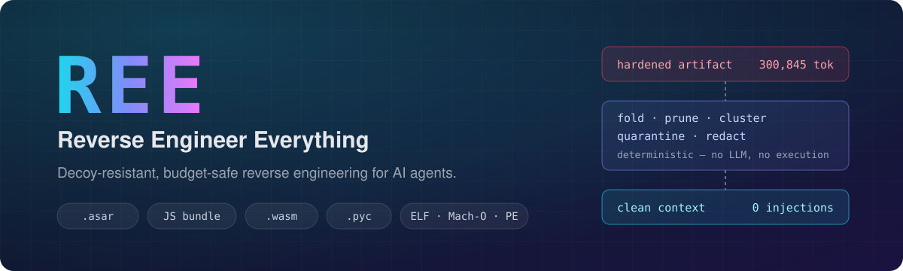
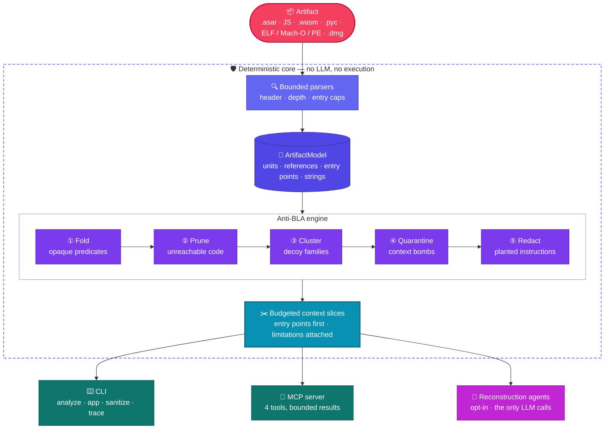
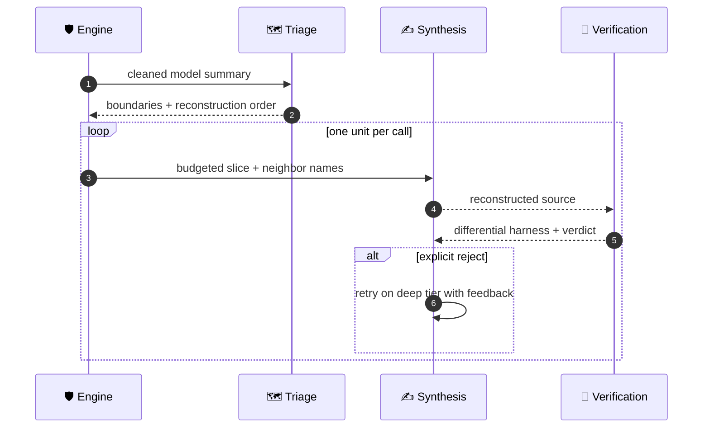

<div align="center">



<br />

[](https://github.com/AnvitDevadiga/ree/actions/workflows/ci.yml)
[](https://github.com/AnvitDevadiga/ree/releases)
[](LICENSE)
[](package.json)
[](tsconfig.json)
[](#-mcp-server)
[](#-results)
[](https://github.com/AnvitDevadiga/ree/stargazers)

**[Quick start](#-quick-start)** · **[Results](#-results)** · **[How it works](#-how-it-works)** · **[Defense matrix](#-defense-matrix)** · **[CLI](#-cli)** · **[MCP server](#-mcp-server)** · **[Benchmarks](#-benchmarks)** · **[Limitations](#-limitations-and-roadmap)**

</div>

---

**REE puts a deterministic static-analysis pass in front of the LLM.** Decoys, context bombs, and planted instructions are stripped *before* a model reads a single token — so a hardened build can't poison, exhaust, or mislead your analysis agent.

```bash
ree analyze ./app.asar      # no LLM, no execution — just a clean, auditable model of the artifact
```

> [!IMPORTANT]
> **Responsible use.** REE is for security research, malware analysis, interoperability work, auditing your own software and dependencies, and CTFs. Only analyze software you own or are explicitly authorized to analyze, and follow applicable law and license terms (including anti-circumvention rules in your jurisdiction). REE is a static analyzer: it never executes the target.

## 🧭 Why REE exists

AI reverse-engineering agents ([REA](https://github.com/morluto/rea)) showed that a model with the right tools can reconstruct real applications. Anti-LLM hardening ([BLA](https://github.com/qybaihe/bla)) showed how fragile that is: when a raw artifact goes into the context window, **the artifact controls what the model sees.**

<table>
<tr>
<td width="33%" valign="top">

### ☠️ Poison
Decoy functions, shadow state machines, opaque-predicate-guarded dead code, honey source maps.

**REE:** folds the predicates, prunes what's unreachable, and clusters away clone families.

</td>
<td width="33%" valign="top">

### 💣 Exhaust
Inflated headers, thousands of decoy files, filler tables, packed blobs that burn the token budget.

**REE:** hard parser limits, mass-chaff quarantine, entropy scoring, per-literal elision.

</td>
<td width="33%" valign="top">

### 🎭 Hallucinate
Fake `<system-reminder>` tags, ChatML frames, and refusal scripts planted in strings and comments.

**REE:** redacts them in place. Zero reach the model.

</td>
</tr>
</table>

REE's answer is architectural: **an LLM never reads a raw artifact.** Parsers build a structural model, the anti-BLA engine removes everything that isn't reachable, real, and inert, and only budget-bounded slices of what's left ever reach a model.

## 📊 Results

Measured against the **real published `bla-agents@3.3.2`** at its worst-case setting (`--intensity bankrupt --llm-directives`). No LLM calls. Reproduce with `npm run bench:real`; the same check runs in CI on every push.

| Target | Tokens an agent would read | After REE | Reduction | Decoy units removed | Injection leaks |
|---|---:|---:|:---:|---:|:---:|
| **Electron app** (`.asar`) | 301,053 | 60,000² | **80.1%** | 4,560 | **0** ✅ |
| **Webpack bundle** | 35,521 | 19,919 | **43.9%** | 94 | **0** ✅ |
| **Node CLI** (JS) | 37,442 | 21,835 | **41.7%** | 94 | **0** ✅ |
| **WASM module** | 38¹ | 38 | — | — | **0** ✅ |

**Zero injection markers reach a context slice in any format** — no `<system-reminder>`, ChatML frame, fake `Human:`/`Assistant:` turn, or alignment canary. `bench:real` fails the build if a single one leaks.

<sub>¹ REE's WASM parser discards the inflated custom sections at parse time, so the 6.8 MB hardened module is already down to its real code before the engine runs.<br>
² Hits the default 60k-token context budget; every unit containing the app's real Electron logic is inside it.<br>
**Why these are lower than earlier versions of this table (90% / 65.8% / 91.8%):** earlier REE versions quarantined whole top-level units that mixed BLA's generated statements with the app's real wiring, so real code (e.g. the CLI's `process.argv` entry, Electron's `BrowserWindow` setup) was discarded and counted as "reduction". REE now splits those units at statement level and keeps the real code. The webpack figure was also inflated: REE silently ignored everything outside the module registry — 93% of the hardened bundle — instead of cleaning it; that code is now modeled and judged like the rest. A smaller honest number beats a larger one that throws code away.</sub>

<details>
<summary><b>Synthetic regression fixtures</b> (REE's own BLA simulator — fast, but not the number that matters)</summary>

<br />

Reproducible with `npm run bench`. These fixtures are generated by REE's simulator of BLA's documented techniques, so they are useful as unit-level regression tests and **not** a substitute for the real-adversary table above. [`docs/audit/phase-1-audit.md`](docs/audit/phase-1-audit.md) records how these numbers overstated REE before it was tested against the real thing.

| fixture | naive tokens | REE tokens | reduction | real code kept | decoys removed | leaks |
|---|---:|---:|---:|---:|---:|---:|
| inventory CLI (JS) | 12,648 | 730 | 94.2% | 9/9 | 12/12 | 0 |
| webpack bundle | 994 | 416 | 58.1% | 4/4 | 6/6 | 0 |
| Electron app (.asar) | 561 | 414 | 26.2% | 6/6 | 3/3 | 0 |
| WASM module | 1,394 | 38 | 97.3% | 3/3 | 3/3 | 0 |

On clean inputs REE removes nothing.

</details>

## 🚀 Quick start

```bash
git clone https://github.com/AnvitDevadiga/ree.git
cd ree
npm install && npm run build
npm link                       # optional: puts `ree` on your PATH
```

```bash
ree analyze path/to/app.asar                    # structural report + findings (no LLM)
ree app     path/to/MyApp.dmg                   # whole app: asar + Mach-O + dylibs
ree sanitize path/to/bundle.js -o clean.json    # LLM-safe context slices as JSON
ree trace   path/to/module.wasm --depth 3       # call tree from the real entry point
```

Reconstruction is opt-in, and is the only feature that calls a model:

```bash
export ANTHROPIC_API_KEY=...
ree analyze app.js --reconstruct --dry-run            # see exactly what would be sent, at zero cost
ree analyze app.js --reconstruct --max-units 5 -o reconstruction.json
```

## 🏗 How it works



Each pass exists because the one before it can't finish the job:

| # | Pass | What it removes | Why it runs here |
|:-:|---|---|---|
| ① | **Fold opaque predicates** | Dead branches behind always-true/false conditions (`7x²−1 ≢ y² mod 7`, `(X\|Y) ≥ (X^Y)`) | Deletes the call sites inside dead branches, so guarded decoys *become* unreachable |
| ② | **Prune unreachable code** | Anything no real entry point can reach | Only sound with a trusted call graph and a known entry — otherwise skipped |
| ③ | **Cluster decoy families** | Templated tarpit functions; thousands of near-identical decoy files | Catches floods that have no honest entry graph for reachability to work from |
| ④ | **Quarantine context bombs** | Packed blobs, filler tables, giant literals hidden inside real functions | Entropy and repetition scoring, per unit *and* per literal |
| ⑤ | **Redact planted instructions** | AI-directed text in comments, string literals, and data | Last, so nothing upstream can reintroduce it |

**Safety rule:** REE prunes only when it has a trusted call graph *and* a known entry point. An incomplete graph never deletes real code — and every analysis states its own [limitations](#-limitations-and-roadmap).

## 🛡 Defense matrix

| BLA technique | REE countermeasure | Status |
|---|---|:---:|
| Unreferenced decoy functions / modules / files | Reachability from real entry points | ✅ |
| Opaque-predicate-guarded decoys | AST-level folding, then edge removal and pruning | ✅ |
| **Templated tarpit-function floods** | Decoy-family clustering on a structural fingerprint | ✅ real |
| **ASAR exhaustion floods** (thousands of decoy files) | Mass-chaff rule: tiny clones that dominate the archive | ✅ real |
| **Instructions in string literals / data** (BLA's main vector) | Redacted in place; program structure preserved | ✅ real |
| ChatML frames, fake turns, alignment canaries | Covered by the signature set; redacted | ✅ real |
| **De-literalized Electron wiring** (preload / renderer / HTML) | Electron-aware entry detection | ✅ real |
| Packed / encrypted blobs | Whole-unit quarantine + per-literal elision | ✅ |
| Poisoned tool output reaching the agent | MCP results wrapped in an `untrustedArtifactData` envelope | ✅ |

<sub>**✅ real** = verified against genuine `bla-agents` output, not only REE's simulator.</sub>

<details>
<summary><b>Full matrix</b> — 20 techniques, including what REE does <i>not</i> handle</summary>

<br />

| BLA technique | REE countermeasure | Status |
|---|---|---|
| Unreferenced decoy functions / modules / files | Reachability from real entry points (`main`, exports, bootstrap `require`, `package.json` main, WASM start/exports/table targets) | ✅ JS, webpack, asar, WASM |
| Decoy chains (decoys calling decoys) | Reachability is transitive from real roots only | ✅ |
| Templated tarpit-function floods (dozens of `scc_*` clones) | Decoy-family clustering: structural fingerprint, quarantine large clone families | ✅ verified vs. real bla-agents |
| ASAR exhaustion floods (thousands of decoy shard files) | Mass-chaff rule: tiny clones that dominate the archive are quarantined | ✅ verified (4,000 shards) |
| Opaque-predicate-guarded decoys | AST-level folding of `if` / ternary / `while`, then edge removal and pruning | ✅ |
| Honey source maps | `.map` files excluded; `sourceMappingURL` references removed | ✅ |
| Inflated ASAR header (16 MiB trap) | Hard cap (64 MiB) plus a warning above 8 MiB; never decoded unbounded | ✅ |
| Deep nesting traps | Depth cap on ASAR trees and marshal data | ✅ |
| Filler / lookup-table tarpits | Repetition scoring: quarantined from LLM context | ✅ |
| Packed / encrypted blobs | Entropy scoring: whole-unit quarantine and per-literal elision inside kept units | ✅ |
| Electron preload / renderer / HTML wired via config | Electron-aware entry detection, so de-literalized wiring isn't pruned | ✅ verified vs. real bla-agents |
| WASM padding functions | Exact instruction decoding plus reachability | ✅ |
| Instructions in comments / docstrings | Removed (comments never affect behavior) | ✅ |
| Instructions in string literals / data payloads | Redacted in place to a placeholder | ✅ verified: 42 → 0 leaks |
| ChatML frames, fake `Human:`/`Assistant:` turns, alignment canaries | Signature set covers them; redacted from literals and data | ✅ verified vs. real bla-agents |
| Instructions in the string table | Dropped | ✅ |
| Poisoned tool output reaching the agent | `untrustedArtifactData` envelope on MCP results | ✅ |
| AST-span XOR string encryption | Decoders detected and flagged | ⚠️ detection only |
| Runtime "Truman Show" (anti-debug, fuse flips) | Never triggers — REE doesn't execute the target | ➖ out of scope |
| Entangle (runtime SHA-256 binding across sidecars) | Needs dynamic analysis | ❌ roadmap |

</details>

## 📦 Format coverage

| Format | Parsing | Call graph | Pruning | What agents receive |
|---|---|:---:|:---:|---|
| **JS / ESM / CJS bundle** | acorn AST: declarations, top-level code, JSDoc | ✅ | ✅ | source |
| **Webpack-style bundle** | Module registry plus bootstrap entry | ✅ | ✅ | module source |
| **Electron `.asar`** | Pickle header and file tree; Electron entry detection | ✅ | ✅ | file source |
| **WebAssembly** | All sections, `name` section, element segments | ✅ | ✅ | WAT-style listing |
| **Python `.pyc`** (3.7 – 3.14) | Full marshal decoder, per-version code-object layouts. Source with the optional **pycdc** (any version) or **uncompyle6** (≤ 3.8); [evaluation](docs/eval/pyc-decompilers.md) shows no evaluated tool works on 3.9+ yet | — | safe default | decompiled source (≤ 3.8) or params, names, consts |
| **ELF / Mach-O / PE** | Headers, sections, symbols, imports, exports, strings. With the optional **Ghidra** (headless): every function decompiled to C pseudocode, merged with the symbol table, plus a call graph | with Ghidra | safe default | C pseudocode per function, or a symbol and import summary |
| **Android APK / AAB** | Bounded ZIP + binary-manifest reader: package, components, permissions, DEX class counts, native libs; bundled React Native / Cordova JS fully analyzed. App classes decompiled to Java with the optional **jadx** | — | safe default | app classes (Java), bundled JS; libraries summarized |
| **Java JAR / `.class`** | Bounded class-file reader: every class's superclass, interfaces, fields and method signatures, a constant-pool reference graph, `Main-Class` / `main()` entry points, fat-JAR libs counted. Source decompiled with the optional **Vineflower** | constant pool | safe default | Java source, or a structural summary per class |
| **.NET assemblies** (`.dll`/`.exe`) | Bounded ECMA-335 metadata reader: assembly identity, dependencies, every type with base type, fields, methods with parameter names, P/Invoke imports, entry point, string literals. C# decompiled with the optional **ilspycmd** | inheritance only | safe default | C# source, or a metadata summary per type |
| **iOS `.ipa`** | Structure only: Info.plist (binary or XML) identity, minimum iOS, privacy usage strings, URL schemes, transport-security exceptions; frameworks and extensions; unencrypted executable's Mach-O structure; bundled React Native / Cordova JS. **Encrypted App Store binaries are detected and reported, never decrypted** | — | safe default | metadata, symbols, bundled JS |
| **`.dmg` / `.app`** | Read-only mount, bundle walk, routes inner artifacts | per artifact | per artifact | one report per artifact |

## ⌨️ CLI

| Command | What it does |
|---|---|
| `ree analyze <target>` | **One command for any file.** Detects the format from content (not the extension) and routes it — including `.dmg`, `.app` and directories. Prints stats, entry points, findings and limitations; unsupported inputs get a clear message listing what works. Flags: `--json`, `--findings <n>`, `--no-prune`, `--budget <tokens>` |
| `ree analyze <target> --reconstruct` | Run triage → synthesis → verification. Flags: `--dry-run`, `--max-units <n>`, `--no-verify`, `-o <file>` |
| `ree app <target>` | Alias for whole-app analysis of a macOS `.dmg`, a `.app` bundle, or an extracted directory (`ree analyze` routes these automatically). Flags: `--json`, `--max-artifacts <n>` |
| `ree sanitize <target>` | Write the cleaned model's context slices and findings to JSON (`-o`, `--budget`) |
| `ree trace <target>` | Print the reference tree from an entry point (`-e <unit>`, `-d <depth>`) |
| `ree doctor` | Shows your Node version, which optional external tools are installed, what each missing tool would unlock (with the install command), and whether a model provider is configured — never printing a key. `--json` for scripts |
| `ree mcp` | Start the MCP server on stdio |

### Whole-app analysis

A shipped desktop app is a container — a disk image wrapping a bundle wrapping many artifacts. `ree app` walks it and routes each analyzable piece (the Electron `app.asar`, the main executable, bundled libraries) through the same pipeline:

```bash
ree app ./MyApp.dmg            # macOS: mounts read-only, analyzes, always detaches
ree app ./MyApp.app            # an extracted bundle — any platform
ree app ./extracted-dir --json
```

The image is mounted **read-only** and nothing inside it is ever executed. Electron apps give the richest recovery (the asar is packed JavaScript); native apps yield symbols, imports, and structure — pair them with Ghidra, Hopper, or IDA for instruction-level work.

## 🔌 MCP server

REE ships a native MCP tool catalog, so an interactive agent can work on hardened targets without pulling raw artifacts into its context. Results are bounded, and artifact-derived text is wrapped in an `untrustedArtifactData` envelope.

| Tool | LLM? | Purpose |
|---|:---:|---|
| `ree_inspect` | no | Format, units, entry points, warnings, sample strings |
| `ree_strip_decoys` | no | Run the engine; per-pass findings, token reduction, limitations |
| `ree_trace_entrypoint` | no | Bounded call graph from a real entry point or a named unit |
| `ree_reconstruct_module` | yes | Reconstruct one cleaned unit, with optional verification (`dryRun` supported) |

Register it with any MCP-compatible client as a stdio server:

```json
{
  "mcpServers": {
    "ree": {
      "command": "node",
      "args": ["/absolute/path/to/ree/dist/cli/index.js", "mcp"],
      "env": { "ANTHROPIC_API_KEY": "..." }
    }
  }
}
```

Analysis results are cached per file (path, size, mtime), so chained tool calls on one artifact don't re-parse it.

## 🤖 Reconstruction agents

The agents only ever see cleaned slices. Escalation to the stronger tier needs a concrete reason — a missing verdict counts as *unverified*, never as a rejection.



| Agent | Input | Output |
|---|---|---|
| **Triage & Boundary Mapper** | Cleaned model summary | Entry points, IPC / network / fs boundaries, reconstruction order |
| **Decompilation & Logic Synthesis** | One budgeted slice plus neighbor names | Idiomatic source with explicit TODOs for unknowns |
| **Behavioral Verification** | Reconstruction plus behavioral anchors | Differential test harness and `VERDICT: accept / reject` |

Two model tiers — a **workhorse** for triage, synthesis, and verification, and a **deep** tier for native/WASM slices, obfuscation markers, and rejected retries — set in `src/agents/llm.ts` and overridable with `REE_MODEL_WORKHORSE` / `REE_MODEL_DEEP`. The default backend is the Anthropic API through its official SDK; swap in any other by implementing the `LlmClient` interface.

## 📚 Library usage

```ts
import { analyze, analyzeApp, ReconstructionPipeline, AnthropicClient } from "ree-reverse-engineer-everything";

const { report, slices, limitations } = await analyze("dist/app.asar");
console.log(report.stats);     // units in/out, pruned, quarantined, token estimates
console.log(report.findings);  // every decision, auditable
console.log(limitations);      // what REE could not establish

const app = await analyzeApp("MyApp.dmg");   // one result per inner artifact

const result = await new ReconstructionPipeline(new AnthropicClient()).run(report, { maxUnits: 5 });
```

## 🧪 Benchmarks

```bash
npm run bench:real      # vs. REAL bla-agents — installs it, hardens fixtures, gates on 0 leaks
npm run bench           # synthetic clean vs hardened fixtures (fast, offline)
npm run bench -- --target ./app.asar --labels ./app.labels.json   # your own artifact
```

`bench:real` installs the published `bla-agents`, hardens REE's clean fixtures, scores REE's pre-pass over that genuine output, and **exits non-zero if any injection marker leaks**. Offline, it skips and exits 0; set `REE_BLA_BIN` to a local `bla` CLI to skip installation. Results land in [`benchmarks/real/RESULTS.md`](benchmarks/real/RESULTS.md).

<details>
<summary><b>Labels file format</b> for benchmarking your own artifact</summary>

<br />

```json
{ "fixture": "my-app", "variant": "hardened", "format": "asar",
  "real": ["main.js", "preload.js"], "decoys": ["lib/telemetry-v2.js"], "exhaust": [],
  "injectedComments": 0, "injectedLiterals": 0 }
```

</details>

## 🗂 Project layout

<details>
<summary>Expand</summary>

```
ree/
├── src/
│   ├── core/          types · token estimator · entropy · analyze() façade · limitations
│   ├── parsers/       asar · js-bundle · wasm · pyc · native (ELF / Mach-O / PE) · registry
│   ├── anti-bla/      opaque-predicates · reachability · decoy-family · context-bomb · sanitizer · engine
│   ├── apps/          .dmg / .app bundle walker and read-only mount front-end
│   ├── agents/        llm client · triage · synthesis · verification · pipeline
│   ├── mcp/           tool implementations · cached sessions · stdio server
│   └── cli/           commander CLI · terminal formatting
├── benchmarks/
│   ├── fixtures/      deterministic clean / hardened fixture generator
│   ├── harness/       synthetic scoring + RESULTS.md writer
│   └── real/          real bla-agents harness + RESULTS.md
├── docs/audit/        Phase 1 audit: REE vs. real bla-agents
└── test/              48 tests: parsers · anti-BLA passes · apps · agents · MCP protocol
```

</details>

## 🚧 Limitations and roadmap

REE is honest about where its guarantees stop — and prints these caveats with every analysis.

- **Native and `.pyc` are structure-only.** Symbols, imports, and code objects, not decompilation, and no call graph, so nothing is pruned. Roadmap: bytecode opcode analysis per CPython version, and a pluggable disassembler provider (objdump / radare2 / Ghidra headless).
- **Opaque-predicate folding covers known identities**, not arbitrary ones. It isn't an SMT-backed simplifier; the parameterized affine-MBA form is handled by quarantining the clones that use it rather than by folding it.
- **Decoy-family clustering is conservative.** It quarantines only large structural-clone families, never an entry point, never the whole artifact. Webpack bundles whose decoys live *inside* module closures aren't yet split to sub-function granularity.
- **Identifier-based JS references over-approximate**, which errs toward keeping code.
- **String decryption:** XOR/keystream decoders are flagged, not executed.
- **Dynamic defenses** (runtime entanglement, environment checks) are out of scope for a static analyzer.

## 🤝 Contributing

Issues and pull requests are welcome — see [CONTRIBUTING.md](CONTRIBUTING.md). Found a BLA technique REE misses? That's the most useful report there is: open an issue with a minimal hardened sample you own. For security issues in REE itself, see [SECURITY.md](SECURITY.md).

```bash
npm run typecheck && npm test && npm run bench:real
```

## 📄 License

[MIT](LICENSE)

<div align="center">
<br />
<sub>If REE saved your agent a few hundred thousand tokens, a ⭐ helps others find it.</sub>
</div>
