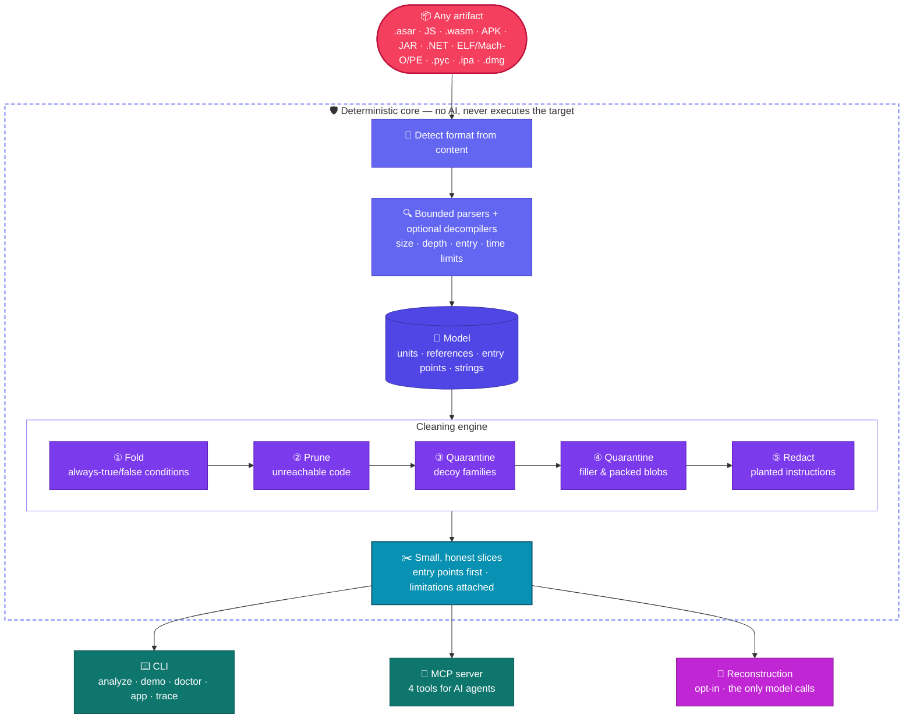

<div align="center">


<br />

[](https://github.com/AnvitDevadiga/ree/actions/workflows/ci.yml)
[](https://github.com/AnvitDevadiga/ree/releases)
[](LICENSE)
[](package.json)
[](.github/workflows/ci.yml)
[](#-mcp-server)
[](#-results)
[](https://github.com/AnvitDevadiga/ree/stargazers)

**[Try it](#-try-it-in-30-seconds)** · **[Demo](#-demo)** · **[Formats](#-supported-formats)** · **[Results](#-results)** · **[How it works](#-how-it-works)** · **[CLI](#-cli)** · **[MCP](#-mcp-server)** · **[Limitations](#-limitations)** · **[Responsible use](#-responsible-use)**

</div>

---

**REE helps you understand how software works** — Electron apps, JavaScript bundles, WebAssembly, Android apps, Java, .NET, native binaries, Python bytecode and iOS bundles. It reads an artifact **statically** (it never runs it), cleans out anything planted to mislead an analyst — decoy code, filler, instructions aimed at AI models — and gives you, and optionally an AI model, a small, honest view of what the code actually does. Use it to **study, audit and learn**: inspect a dependency you ship, audit your own release, analyze malware, or see how an open-source app is built.

## ⚡ Try it in 30 seconds

```bash
npx ree-reverse-engineer-everything demo                     # bundled samples, no setup
npx ree-reverse-engineer-everything analyze ./your-file      # any supported format, detected from content
```

Needs Node 22+. Nothing else: optional decompilers add more depth when installed (`ree doctor` shows what you have).

## 🧭 Responsible use

> [!IMPORTANT]
> - **REE is static-only.** It reads files; it never executes, installs or runs what it analyzes. `.dmg` images are mounted read-only.
> - **You are responsible for complying with the licenses and laws that apply to what you analyze**, including terms of service and anti-circumvention rules in your jurisdiction. Analyze software you own, are authorized to study, or that is open source.
> - **Learning from proprietary software is fine; copying it is not.** Study how something works, then write your own code. Don't paste recovered proprietary code into your product.
> - **Open-source code may be reused only under its license** — keep attribution for MIT/Apache, and honor copyleft for GPL.
> - **REE produces understanding, not modified binaries.** It never decrypts App Store apps, removes license checks, re-signs or repackages anything.

## 🎬 Demo

A minified bundle goes in; readable source comes out. Below is a real run — the input is
[`samples/escape-dlv.min.js`](samples/escape-dlv.min.js) (escape-html + dlv, MIT), the output is
what REE's reconstruction pipeline produced with **`openai/gpt-oss-120b` on Groq** (not a Claude
model), and the last column is the real original source.

<table>
<tr><th>What ships (minified)</th><th>What REE reconstructed</th><th>The real source</th></tr>
<tr valign="top">
<td>

```js
function A(r){var t=""+r,e=w.exec(t);
if(!e)return t;var a,s="",c=0,i=0;
for(c=e.index;c<t.length;c++){
switch(t.charCodeAt(c)){
case 34:a="&quot;";break;
case 38:a="&amp;";break;
case 39:a="&#39;";break;
case 60:a="&lt;";break;
case 62:a="&gt;";break;
default:continue}
i!==c&&(s+=t.substring(i,c)),
i=c+1,s+=a}
return i!==c?s+t.substring(i,c):s}
```

</td>
<td>

```js
function escapeHtml(input) {
  const str = '' + input;
  const firstMatch = /["'&<>]/.exec(str);
  if (!firstMatch) return str;
  let result = '';
  let last = 0;
  for (let i = firstMatch.index; i < str.length; i++) {
    let entity;
    switch (str.charCodeAt(i)) {
      case 34: entity = '&quot;'; break;
      case 38: entity = '&amp;';  break;
      case 39: entity = '&#39;';  break;
      case 60: entity = '&lt;';   break;
      case 62: entity = '&gt;';   break;
      default: continue;
    }
    if (last !== i) result += str.substring(last, i);
    result += entity;
    last = i + 1;
  }
  if (last !== str.length) result += str.substring(last);
  return result;
}
```

</td>
<td>

```js
function escapeHtml(string) {
  var str = '' + string;
  var match = matchHtmlRegExp.exec(str);
  if (!match) return str;
  var escape, html = '';
  var index = 0, lastIndex = 0;
  for (index = match.index; index < str.length; index++) {
    switch (str.charCodeAt(index)) {
      case 34: escape = '&quot;'; break;
      case 38: escape = '&amp;';  break;
      case 39: escape = '&#39;';  break;
      case 60: escape = '&lt;';   break;
      case 62: escape = '&gt;';   break;
      default: continue;
    }
    if (lastIndex !== index) html += str.substring(lastIndex, index);
    lastIndex = index + 1;
    html += escape;
  }
  return lastIndex !== index
    ? html + str.substring(lastIndex, index) : html;
}
```

</td>
</tr>
</table>

The model recovered the real name (`escapeHtml`, minified to `A`) and the function passed every
behavioral probe. That is one good run, not a guarantee — see the [reconstruction benchmark](#reconstruction-quality)
for failures too. (Formatting of the middle and right columns is condensed here to fit.)

## 📦 Supported formats

`ree analyze` detects the format from the file's content, not its name.

| Format | Always (no tools needed) | Optional tool → what it unlocks | Platforms |
|---|---|---|---|
| **Electron `.asar`** | file tree, entry points (incl. preload/renderer/HTML), full JS analysis | — | all |
| **JavaScript** (webpack, esbuild, rollup, UMD, plain) | function-level units, call graph, runtime code, decoy cleaning | — | all |
| **WebAssembly** | all sections, decoded WAT, exact call graph | — | all |
| **Android APK / AAB** | manifest (package, components, permissions), DEX class counts, native libs, bundled React Native / Cordova JS | **jadx** → app classes as Java | all |
| **Java JAR / `.class`** | every class's fields, method signatures and references, `Main-Class` | **Vineflower** → Java source | all |
| **.NET** `.dll` / `.exe` | types, methods with parameter names, dependencies, P/Invoke, entry point, string literals | **ilspycmd** → C# source | all |
| **Native** ELF / Mach-O / PE | headers, symbols, imports, exports, strings | **Ghidra** (headless) → C per function + call graph | all |
| **Python `.pyc`** (3.7–3.14) | code objects, names, constants, parameters | **uncompyle6** (≤ 3.8) / **pycdc** (3.9–3.12, partial) → Python source | all |
| **iOS `.ipa`** | bundle identity, permissions, URL schemes, frameworks, bundled JS, unencrypted executable structure — **encrypted App Store binaries are detected, never decrypted** | — | all |
| **`.dmg` / `.app` / directories** | walks the bundle and analyzes every inner artifact | **hdiutil** → `.dmg` mounting | `.dmg`: macOS |

Every tool is optional, detected at runtime, never bundled, and treated as **untrusted**: its output
passes through the same cleaning as everything else. `ree doctor` lists what's installed and the exact
command for anything missing. Licenses: [`THIRD_PARTY_NOTICES.md`](THIRD_PARTY_NOTICES.md).

## 📊 Results

Every number here is reproducible with the command shown, and the gates run in CI.

### Reconstruction quality

Four small open-source projects, rebuilt with REE's full pipeline and compared with the real source
(**`openai/gpt-oss-120b` on Groq**, not a Claude model; [full write-up](docs/eval/reconstruction.md)).
Two complete runs each with the current pipeline:

| Fixture | Function recall | Behavioral probes passed | Cost per run |
|---|---:|---:|---:|
| `ms` (bundled) | 4/4 · 4/4 | **3/3 · 3/3** | $0.003–0.006 |
| `escape-html` + `dlv` (minified) | 2/2 · 2/2 | **2/2 · 2/2** | $0.003–0.006 |
| `kleur` (in an `.asar`) | 3/3 · 3/3 | not probed | $0.006–0.008 |
| `colorsys` (`.pyc`) ¹ | 7/7 · 7/7 | not probed | ≈ $0.017 |

**Honest caveats:** results vary between runs (an earlier run returned a broken `escapeHtml` that
the verifier accepted, so only the behavioral probes count). The fixtures are small, and only one
model has been measured.
<sub>¹ Measured in the earlier runs; `.pyc` does not use slice packing. Its summary already contains
every function name, so recall here measures nothing about the model.</sub>

### Against real anti-AI hardening

Measured on output of the real published [`bla-agents`](https://github.com/qybaihe/bla) at its strongest
setting (`npm run bench:real`):

| Target | Tokens an AI would read | After REE | Reduction | Decoy units removed | Planted instructions reaching the model |
|---|---:|---:|:---:|---:|:---:|
| Electron app (`.asar`) | 301,053 | 60,000² | **80.1%** | 4,560 | **0** |
| Webpack bundle | 35,521 | 19,919 | **43.9%** | 94 | **0** |
| Node CLI (JS) | 37,442 | 21,835 | **41.7%** | 94 | **0** |

<sub>² Capped by the default 60k-token context budget; every unit with the app's real logic is inside it.
Earlier versions of this table showed higher reductions (90% / 91.8% / 65.8%) that came from REE discarding
real code or silently ignoring code outside a webpack registry; [the audit](docs/audit/phase-1-audit.md) and
[protection report](docs/eval/protections.md) explain the fixes. A smaller honest number beats a larger one
that throws code away.</sub>

### Against standard protections

`npm run bench:obfuscation` ([report](docs/eval/protections.md)):

| Protection | Parses to functions | Real strings visible | Planted instructions reaching the model |
|---|:-:|:-:|:-:|
| Terser (minification) | ✅ | 100% | 0 |
| javascript-obfuscator — low / medium | ✅ | 100% | 0 |
| javascript-obfuscator — high (rc4 string array) | ✅ | 22% / 85% — flagged | 0 |
| R8 (Android) → Vineflower / jadx | ✅ | 100% · 2/5 method names | 0 |

## 🏗 How it works



| # | Pass | What it removes | Why it's safe |
|:-:|---|---|---|
| ① | **Fold conditions** | Dead branches behind provably constant conditions (`7x²−1 ≢ y² mod 7`, `(X\|Y) ≥ (X^Y)`) | Only identities that hold for every input are folded |
| ② | **Prune unreachable code** | Code no real entry point can reach | Only with a trusted call graph and a known entry point |
| ③ | **Quarantine decoy families** | Large families of near-identical generated functions or files | Never an entry point, never the whole artifact |
| ④ | **Quarantine filler** | Packed blobs and filler, judged per statement and per literal | Real statements next to a blob are kept |
| ⑤ | **Redact planted instructions** | Text aimed at AI models in comments, strings and data — including escaped (`\x20`) and split strings | Changes only what is read, never the artifact |

Every analysis also reports **what REE could not establish** (missing tools, encrypted parts, incomplete
graphs). It never presents a guess as a fact.

<details>
<summary><b>Anti-AI hardening techniques and how REE handles each</b></summary>

<br />

| Technique | REE's handling | Status |
|---|---|---|
| Unreferenced decoy functions / modules / files | Reachability from real entry points | ✅ |
| Opaque-predicate-guarded decoys | AST-level folding, then pruning | ✅ |
| Templated decoy-function floods | Near-duplicate family detection on a structural fingerprint | ✅ verified on real bla-agents |
| Archive floods (thousands of decoy files) | Mass-duplicate rule | ✅ verified (4,000 files) |
| Instructions in comments, strings and data | Redacted in place; structure preserved | ✅ verified: 42 → 0 |
| Escaped / split instruction strings | Escapes decoded and fragments joined before matching | ✅ |
| ChatML frames, fake `Human:`/`Assistant:` turns, canaries | Redacted | ✅ |
| Obfuscated Electron wiring | Electron-aware entry detection | ✅ verified |
| Packed / encrypted blobs | Quarantine + per-literal elision | ✅ |
| Honey source maps | Excluded; references removed | ✅ |
| Inflated headers, deep nesting | Hard caps everywhere | ✅ |
| Hostile names in metadata / tool output | Redacted before any model or MCP client sees them | ✅ |
| Obfuscator string arrays (rc4/base64) | Detected and reported; not decoded (would require running the artifact) | ⚠️ |
| XOR string encryption | Decoders flagged, not executed | ⚠️ |
| Runtime anti-debugging | Never triggers — REE doesn't execute anything | ➖ |

</details>

## ⌨️ CLI

| Command | What it does |
|---|---|
| `ree demo` | Analyze the bundled samples — a result in seconds |
| `ree analyze <file>` | Any supported format or app bundle, detected from content. Stats, entry points, findings, limitations. `--json` for scripts |
| `ree analyze <file> --reconstruct` | Rebuild readable source with a model (`--dry-run` shows exactly what would be sent, free) |
| `ree doctor` | Node version, installed optional tools and what each missing one unlocks, model-provider status |
| `ree app <path>` | Alias for `.dmg` / `.app` / directory analysis |
| `ree sanitize <file>` | Write the cleaned slices and findings to JSON |
| `ree trace <file>` | Reference tree from an entry point |
| `ree mcp` | Start the MCP server on stdio |

### Using a model (optional)

Reconstruction is the only feature that calls a model. With nothing configured, REE runs fully
deterministic and says so.

| Provider | Environment |
|---|---|
| Anthropic | `ANTHROPIC_API_KEY`, plus a required spending cap: `REE_MAX_SPEND_USD`, `REE_PRICE_INPUT_PER_MTOK`, `REE_PRICE_OUTPUT_PER_MTOK` |
| Local (Ollama, LM Studio, vLLM) | `REE_OPENAI_BASE_URL=http://localhost:11434/v1`, `REE_MODEL_WORKHORSE=<model>` |
| Any OpenAI-compatible API (e.g. Groq) | `REE_OPENAI_BASE_URL`, `REE_OPENAI_API_KEY`, `REE_MODEL_WORKHORSE`, plus the spending cap above |

Paid calls are priced at their worst case **before** they are sent and refused if they could cross the
cap. Rate limits are paced from the provider's headers.

## 🔌 MCP server

REE gives AI agents (Claude Desktop, Cursor, VS Code and others) four tools to work on an artifact without
pulling raw, hostile bytes into their context. All artifact-derived text is wrapped as untrusted data.

| Tool | Calls a model? | Purpose |
|---|:---:|---|
| `ree_inspect` | no | Format, units, entry points, warnings, sample strings |
| `ree_strip_decoys` | no | Run the cleaning engine; findings, token reduction, limitations |
| `ree_trace_entrypoint` | no | Bounded call graph from an entry point |
| `ree_reconstruct_module` | yes | Reconstruct one cleaned unit (`dryRun` supported) |

```json
{ "mcpServers": { "ree": { "command": "npx", "args": ["-y", "ree-reverse-engineer-everything", "mcp"] } } }
```

## 📚 Library

```ts
import { analyze, analyzeApp } from "ree-reverse-engineer-everything";

const { report, slices, limitations } = await analyze("dist/app.asar");
console.log(report.stats, report.findings, limitations);
const app = await analyzeApp("MyApp.dmg"); // one result per inner artifact
```

## 🧪 Benchmarks

| Command | Measures |
|---|---|
| `npm run bench:real` | Against real `bla-agents` output; fails on any leaked instruction |
| `npm run bench:obfuscation` | Terser, javascript-obfuscator (3 levels), R8; regression gates |
| `npm run bench:reconstruct` | Reconstruction vs. real source (needs a model and a spending cap) |
| `npm run bench:pyc` | Python decompilers across Python 3.8–3.14 ([results](docs/eval/pyc-decompilers.md)) |
| `npm run bench` | Fast synthetic regression fixtures |
| `npm run smoke:pack` | The published package, installed into an empty directory |

## 🚧 Limitations

REE prints the relevant caveats with every analysis. The main ones:

- **Decompiled code is an approximation.** Ghidra's C, jadx/Vineflower Java and ilspycmd C# reconstruct
  logic, not original source. Python decompilers are often subtly wrong: pycdc truncates float constants,
  and no evaluated tool decompiles Python 3.13+ ([evaluation](docs/eval/pyc-decompilers.md)).
- **Without the optional tools**, APK, JAR, .NET, native and `.pyc` analysis is structural: names,
  signatures, references — not method bodies.
- **Some protections are reported, not undone:** encoded obfuscator string arrays (decoding would mean
  running the artifact), control-flow flattening and injected dead code. Identifiers removed by minifiers
  or R8 cannot be recovered by any static tool.
- **Encrypted iOS App Store binaries cannot be analyzed** — by design, REE does not decrypt them.
- **Reconstruction quality is measured on small fixtures and one model** so far; treat model output as a
  draft to verify.
- **Static only:** behavior that only appears at runtime is not observed. `.dmg` mounting needs macOS.

## 🤝 Contributing

Issues and pull requests are welcome — see [CONTRIBUTING.md](CONTRIBUTING.md). The most useful report is
a technique REE misses, with a minimal sample you own or that is open source. Security issues:
[SECURITY.md](SECURITY.md).

```bash
npm ci && npm run typecheck && npm test && npm run bench:real && npm run smoke:pack
```

## 📄 License

[MIT](LICENSE). Optional tools and test fixtures keep their own licenses — see
[THIRD_PARTY_NOTICES.md](THIRD_PARTY_NOTICES.md).

<div align="center">
<br />
<sub>If REE helped you understand something, a ⭐ helps others find it.</sub>
</div>
